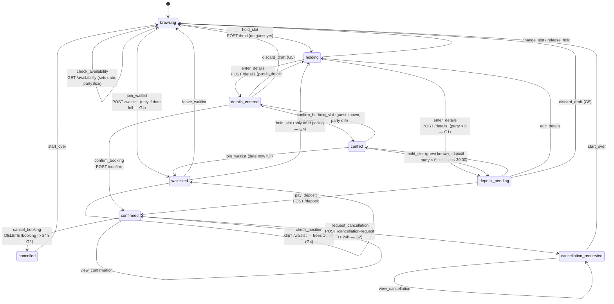

# B1 — the booking site as a state machine

Reference description of the hypermedia site used in the experiment. Source of
truth is `prototype/b1/model.ts` (state + valid action set) and
`prototype/b1/server.ts` (transitions). Nothing here is a design proposal — it
documents what is implemented and verified.

The one line the whole design serves:

> **合法动作集合必须是「服务端所持状态」的函数，而不是「动作名 + 常识」的函数。**

`validAffordances(session)` is the load-bearing function. The server renders
exactly that set and nothing else, and `guard()` refuses anything outside it with
**409**. So an invalid action is not discouraged — it is unrepresentable.

---

## 1. The state

```ts
interface Session {
  status: Status              // the 9 nodes below
  date?: string               // "tomorrow" | "next-week" | "saturday"
  partySize?: number          // > 6 flips G1
  slot?: string               // "17:00".."21:00"
  guest?: { name, phone }
  bookingId?: string
  preorder: { status: "none"|"open"|"submitted", dishes: string[] }
  depositPaid?: boolean       // G1
  waitlistPosition?: number   // G4
  waitlistPolled?: boolean    // G4 — polling FREES a table
  conflictSlot?: string       // slot lost at confirmation
  cancellationReason?: string
}
```

`status` alone is 9 values; the full reachable product is **997 states / 3950
transitions** (exhaustively walked by `b1/explore.ts`).

Server-held constants the agent can never infer:

| constant | value | gate |
|---|---|---|
| `LARGE_PARTY` | 6 | G1 |
| `DEPOSIT_PER_GUEST` | €10 | G1 |
| `CANCEL_WINDOW_HOURS` | 24 | G2 |
| `CONTENDED_SLOT` | `20:00` | conflict source |
| `RELEASED_SLOT` | `19:00` | G4 |
| `SLOTS` | 17:00–21:00 | — |

Dates are pre-baked, not derived from a clock, so runs stay reproducible:

| date | hours until seating | taken slots | why it exists |
|---|---|---|---|
| `tomorrow` | 20 | 17:00, 21:00 | **inside** the 24h window → G2 request branch |
| `next-week` | 168 | 18:00 | **outside** the window → G2 plain-cancel branch |
| `saturday` | 54 | all five | fully booked → G4 waitlist branch |

---

## 2. The state graph



Two edges are easy to miss:

- **`browsing --> details_entered|deposit_pending`** — `POST /hold` checks
  `session.guest ? reviewStatus() : "holding"` (`server.ts:83`). After a
  `conflict`, the guest details already exist, so re-holding skips `holding`
  entirely.
- **`waitlisted --> waitlisted`** via `check_position` is a **GET that mutates**:
  it sets `waitlistPolled`, which removes 19:00 from `taken`. A read enlarges the
  valid action set. That is G4.

---

## 3. Valid action set, per status

This table *is* `validAffordances()`. Average across all 997 reachable states:
**2.87 valid actions** — against a 21-entry catalogue, a **7.3:1** ratio.

| status | always valid | conditionally valid |
|---|---|---|
| `browsing` | `check_availability` | `hold_slot` × (free slots) **or** `join_waitlist` — mutually exclusive, server decides (G4) |
| `holding` | `enter_details`, `change_slot`, `release_hold` | — |
| `details_entered` | `confirm_booking`, `edit_details`, `discard_draft` | `open_preorder` if `preorder=none`; `add_dish`/`remove_dish`/`submit_preorder` if `preorder=open` (G3) |
| `deposit_pending` | `pay_deposit`, `edit_details`, `discard_draft` | same pre-order controls (G3) |
| `confirmed` | `view_confirmation` | `cancel_booking` **xor** `request_cancellation` (G2) |
| `conflict` | — | `hold_slot` × (free slots) **or** `join_waitlist` (G4) |
| `waitlisted` | `check_position`, `leave_waitlist` | `hold_slot` once polled (G4) |
| `cancellation_requested` | `view_cancellation`, `start_over` | — |
| `cancelled` | `start_over` | — |

Things deliberately **absent**:

- `confirmed` has **no** `change_slot` / `edit_details`. Once confirmed the
  booking is locked; those are not refused, they do not exist.
- `conflict` has **no** "confirm anyway". Pick another slot or take the waitlist.
- `details_entered` for a large party has **no** `confirm_booking` at all — the
  party never enters that status (G1 branches at `POST /details`).

---

## 4. The five gates

Each gate exists to break one assumption a static tool catalogue must make.

### G1 — deposit threshold

`needsDeposit(s) = s.partySize > 6`. At `POST /details` the server routes to
`details_entered` (→ `confirm_booking`) or `deposit_pending` (→ `pay_deposit`).

**Breaks:** "one goal, one tool." The user intent *confirm the booking* maps to
two different endpoints, and the threshold lives only on the server.

### G2 — cancellation window

`insideCancelWindow(s) = dateInfo(s).hoursUntilSeating ≤ 24`. In `confirmed`,
either `cancel_booking` (`DELETE /booking`, no fields) **or**
`request_cancellation` (`POST /cancellation-request`, **requires a reason**) is
rendered — never both.

**Breaks:** "the same action is available whenever the resource is." Identical
booking, identical intent, different action depending on the clock.

### G3 — pre-order window

The pre-order sub-resource opens only in `details_entered`/`deposit_pending`
with `preorder.status === "none"`, and locks once `submitted`.

**Breaks:** "sub-resources are independently addressable." Availability of the
child depends on the parent's state.

### G4 — waitlist non-monotonicity

Full date → `hold_slot` vanishes, `join_waitlist` appears. Then
`GET /waitlist` (`check_position`) sets `waitlistPolled`, which frees 19:00 and
**puts `hold_slot` back**.

**Breaks:** "the flow is a one-way funnel; the action set shrinks monotonically."
Here a read grows it.

### G5 — same word, different action

| state | user says "cancel" | actual action | endpoint | fields |
|---|---|---|---|---|
| `details_entered` | | `discard_draft` | `DELETE /draft` | none |
| `confirmed`, >24h | | `cancel_booking` | `DELETE /booking` | none |
| `confirmed`, ≤24h | | `request_cancellation` | `POST /cancellation-request` | `reason` **required** |

**Breaks:** "one name is one tool." Three different actions, three URLs, three
semantics, one word.

`goals.ts` reflects this: `discard_draft` sits in its own intent
(`abandon_draft`), separate from `cancel_reservation`. Conflating them is exactly
the mistake G5 exposes.

---

## 5. The conflict mechanism

`CONTENDED_SLOT = "20:00"` looks free while browsing and holding, but `settle()`
(`server.ts:158`) checks at confirmation time:

```ts
if (session.slot === CONTENDED_SLOT && session.conflictSlot === undefined) {
  session.conflictSlot = session.slot;
  session.status = "conflict";
}
```

Deterministic, fires exactly once per session, and `conflictSlot` is then
permanently added to `taken`. This produces a state where the agent's plan is
invalidated by the server without any error being the agent's fault — and where
"confirm anyway" is unrepresentable rather than refused.

`bookingId` is a hash of the session, not a random number, so trajectories stay
byte-reproducible.

---

## 6. The 21-action catalogue

`ALL_ACTION_IDS` — what conditions J and J+ receive, fixed, every step:

```
check_availability  hold_slot     join_waitlist   leave_waitlist  check_position
enter_details       change_slot   release_hold    confirm_booking pay_deposit
edit_details        discard_draft open_preorder   add_dish        remove_dish
submit_preorder     view_confirmation             cancel_booking
request_cancellation              view_cancellation               start_over
```

Five of these are **abandoning edges** — they give up whatever the guest holds:

```
start_over   discard_draft   release_hold   change_slot   leave_waitlist
```

T2/T3 reachability is computed on the graph with these **removed**. Without that,
`start_over` makes the graph strongly connected, every goal is trivially
"reachable", and T3 is empty.

---

## 7. Verified invariants

`b1/check.ts` — **52 748 assertions** over all 997 states / 3950 transitions:

| id | assertion |
|---|---|
| I1 | the rendered control set **equals** `validAffordances()` — both directions, not a subset |
| I2 | every catalogued action **not** in the valid set is refused with 409 and leaves the state unchanged |
| I3 | every rendered control executes successfully when fired immediately |
| I4 | every mutation is Post/Redirect/Get (native) or a panel swap (htmx) |
| I5 | no state is a dead end except the terminal ones |
| I6 | each gate is exercised from both sides |

`a/check.ts` adds **4 230 assertions** on the agent side, including **A4**: the
agent contains no b1-specific or experiment-specific code.

I1 is why H's invalid rate is **0 by construction**. I2 is why `invalid` and
`refused` are identical in every cell of the report — a free consistency check on
the measurement pipeline.
